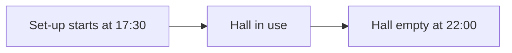

# Knowledge: Programs and the Main Map

Read this file before you write a root note, a part, a map change, a type, or a template, and before you change a place or a drawing. The rules of [[init-ite]] apply with no change. The terms and the folders are in [[knw-ite-reference]].

## The Root Note

`Mesh/Programs/(Program) <Name>/(Program) <Name>.md`. Make it with `flint ite create "<Name>" --purpose "<text>" [--template <id>]`. With no `--template`, the template is a guess from the purpose. The form is [[tmp-ite-program-v0.1]].

| Field | Value |
|---|---|
| `format` | `steel-program/1` |
| `id` | A UUID v4. It never changes. It is the id of the program in `Steel/`. |
| `tags` | `"#ite/program"` |
| `purpose` | One sentence: what the system is, and why a person models it |
| `status` | `active` or `archived` |
| `types` | The type names that the program uses, for example `[Goal, Milestone, Risk]` |
| `from-template` | The id of the template that made the program. History only: nothing decides with it. |
| `main-map` | Optional: `max-children`, `coverage-ignore`, and `card-face` (see The Main Map) |
| `codebase`, `product-root` | Optional, for each template: the codebase of the program, and the folder of the product in it. `codebase` gives the program its file coverage and the `code-refs` of its parts. |
| `template`, `authors`, `orb` | The Flint conventions. `orb` holds the `by` address of `flint address me`. An old note keeps `orbh-sessions`: never remove it, and add no new item to it. |

A root note can have more keys and a fenced block of a later module. Keep each key and each block that this file does not name: a later module reads them.

Example (the program Club Launch Night of this Flint, cut short):

```yaml
---
format: steel-program/1
id: dc6779bd-6476-4837-a444-aea795713354
tags: ["#ite/program"]
purpose: "An example that shows how the ITE models an event: the launch night of a new makers club in Sydney on Thursday 12 November 2026."
status: active
types: [Goal, Milestone, Deliverable, Person, Role, Venue, Resource, Task, Risk, Budget, Note]
from-template: event
template: "[[tmp-ite-program-v0.1]]"
authors: ["[[@Nathan]]"]
---

# Club Launch Night

The Inner West Makers Club starts with a launch night on Thursday 12 November 2026. The goal is that 80 people come and 30 of them join. Start at the goal, then open the milestones.
```

## The Part File

A part is one Mesh note. A new part goes to `Map/` by default, with the name `(Program) <Name> . (<Type>) <Title>.md`. The form is [[tmp-ite-part-v0.1]].

Example: `Map/(Program) Club Launch Night . (Milestone) Venue booked.md`

```yaml
---
id: a9d285ce-53f0-448d-9580-5eff8cef7b1d
tags: ["#ite/part"]
parent: "[[(Program) Club Launch Night . (Goal) A full hall and 30 new members]]"
depends-on: ["[[(Program) Club Launch Night . (Budget) Venue hire]]"]
owner: "[[(Program) Club Launch Night . (Person) Priya Nair]]"
date: "2026-09-24"
template: "[[tmp-ite-part-v0.1]]"
authors: ["[[@Nathan]]"]
---

# (Milestone) Venue booked

Priya booked the hall on 24 September 2026. The booking holds the hall from 17:30 to 22:00. The set-up starts at 17:30, and the hall must be empty at 22:00.
```

The rules of the read:

1. **The type.** The last `(Type)` word of the file name. A note with no `(Type)` word has the type `note`. A change of type is a rename (a map change `rename` with `kind`), and each wikilink changes with it. The part has no field `kind`.
2. **The membership and the parent.** `parent`: one wikilink to the parent part, or to the root note for a top part. A note is a part when its `parent` chain reaches the root note. A part has no field `program`, `include`, or `place`.
3. **The id.** The frontmatter `id` (a UUID) is the key everywhere: each map change and each place names the part by its id. Never change it.
4. **The links.** Each frontmatter key whose value is one wikilink or a list of wikilinks gives one link for each wikilink, with the key as the connection (`next`, `uses`, `depends-on`, `informs`, `owner`, `refers-to`). These keys give no link: `id`, `tags`, `parent`, `template`, `from-template`, `authors`, `orb`, `orbh-sessions`, `artifacts-created`. A wikilink in the prose gives a link of the connection `mentions`.
5. **The text.** The body below the H1, up to the first heading `## For a developer`. The H1 is for a person; no code reads it.
6. **The title.** The file name after the `(<Type>)` word, with no number at its start: a number there reads as the number of an artifact, as in `(Task) 1099 ...`. Start a title with a word: "A full hall and 30 new members", not "80 guests".
7. **No status of the ITE.** The engine reads no `status` of a part. Do not write `status: active`. A note of a type with a status of its own (a Task, a Milestone with the field `status`) keeps its status.
8. **The sources.** `sources` lists the notes and the pages that a part comes from (wikilinks or URLs). In a program with `codebase`, `code-refs` lists the code of the part: a file, a small folder (ends with `/`), a symbol (`path#Name`), or a path of another codebase (`@<Codebase name>/<path>`). Each path must exist.
9. **Keys of a later module.** A part can have more keys of a later module. Keep each key that this file does not name. With the default setting, each part shows as a plain card of its type.

**One writer of the structure.** Each change of the tree (add, move, rename, merge, remove, a change of type) is a map change. A person's hand change applies at once, with Undo. `flint ite part add` and `part remove` make a map change: a person's change applies at once. An agent's change is a proposal, or, with `--apply` in the mode `direct` ([[init-ite#The Two Modes]]), it applies at once. `flint ite part set` changes only the prose and the fields that are not structure: it refuses `title`, `kind`, and `parent`. A person's `part set` and `flint ite link` write at once; an agent's `part set` and `link` each make one map change (`edit`): a person applies it, or, in the mode `direct`, the agent's `--apply` applies it at once.

## Types, Connections, and Templates

One type system with the Mesh. `flint ite types` lists the types and the connections; `flint ite templates` lists the templates.

**A type** is a type note `Mesh/Metadata/Types/(Type) <Name> (<Shard> Shard).md` with one fenced `type` block. A shard installs it with `types:` in its `shard.yaml`. A Flint adds its own type with a note in `Mesh/Metadata/Types/`.

````markdown
```type
format: steel-type/1
id: milestone
name: Milestone
fields:
  date: { type: date }
  status: { type: text }
capabilities: [dated, has-status, container]
connections: { depends-on: [], owner: [person, role] }
look: { hue: fire, icon: flag, layer: plan }
```
````

1. The type id is the type name in lower case, with spaces as `-`: `Milestone` → `milestone`.
2. A type note with no `type` block is a type with no capability: a plain card. A `(Type)` word that no note defines is a plain type too. The type `note` always exists.
3. When two shards define one type name, the note with a `type` block counts.
4. `connections` names the connection keys that a part of the type uses, each with the type ids that it can point to (an empty list: any type).
5. `look` gives the colour (`hue`), the icon, and the default layer of the canvas legend.
6. The capabilities of the main map: `covers-files` (the part counts for the coverage of the files from its `code-refs`) and `container` (the part can hold other parts on the canvas). The other capabilities (`covers-boundary`, `dated`, `has-status`, `owner`) serve the later modules: keep them in a type.

**A connection** is a note `Mesh/Metadata/Types/(Connection) <Name> (<Shard> Shard).md` with one fenced `connection` block:

````markdown
```connection
format: steel-connection/1
id: depends-on
key: depends-on
title: depends on
capabilities: [rolls-up]
style: dependency
```
````

The capability `rolls-up` makes the main map show the link at each level as a relation with a count. `next` is a plain connection: an order of the parts. A connection with no capability is a plain reference. `mentions` (a prose link) and `refers-to` are builtin connections. `parent` is not a connection. The field `shown` says when the canvas shows a link: `selected` (the default) or `always` (see Two Kinds of Links).

**A template** is the start of a new program: one note `Mesh/Metadata/Templates/(Template) <Name>.md`. The ITE shard installs six templates as `(Template) <Title> (ITE Shard).md`, with the mode `force`: each new version of the shard writes them again. A template is an instruction for the agent that models a system of that kind, with one fenced `template` block that Steel reads for the New program dialog. The form is [[tmp-ite-template-v0.1]].

````markdown
```template
format: steel-template/1
id: event
title: Event
types: [goal, milestone, deliverable, person, role, venue, resource, task, risk, budget, note]
connections: [next, uses, depends-on, owner, informs, mentions, blocks]
questions: ["Who does what on the night?"]
```
````

`flint ite create` copies the types of the template into the root note (`types`) and writes `from-template`. After that, nothing reads the template. The six templates of the shard are `software`, `process`, `event`, `research`, `organisation`, and `general` ([[(Template) Event (ITE Shard)]] and the others). A template can have more keys of a later module: keep them. To change a template of the shard, write your own template in a new note with another id. Add a type, a connection, or a template only when none fits, and when the person agrees.

## The Main Map

The **main map** of a program is the tree of its parts by `parent`. Each program has one main map. A subsystem is a deeper level of the same main map, not a separate program: a person opens it on the canvas. For a program with a codebase, the code is the sources of the parts (`code-refs`).

### The Tree

- **The root is the root note.** Each part has one `parent`: one wikilink to the parent part, or to the root note for a top part.
- **The 100% rule.** The children of a part together are the whole part: each source of the part belongs to one child. Nothing of the system is outside the tree, and nothing is in it two times.
- **No size limit.** A level has no size limit by default. A program can set one with `max-children`. A part with exactly one child is a finding: merge the child into the part, or give the child its siblings.
- **Relations roll up.** A link of a connection with `rolls-up` (`uses`, `depends-on`, `blocks`) shows at each level as one relation between the two cards whose subtrees hold its two ends, with the count and the connection keys. A link inside one card does not show. A wikilink in the prose (`mentions`), `sources`, and `code-refs` do not roll up.
- **Coverage.** In a program with `codebase` on its root note, each file of `git ls-files` of the product root is covered when one `code-refs` entry of a part (of a type with `covers-files`) is the file, or a folder that holds it. A file that no part covers is a gap. A file that two leaves cover with a whole-file or folder ref is an overlap. A ref of a part that is not a leaf makes no overlap. A slice (`path#symbol` or `path:Lx-Ly`) covers its file and never makes an overlap.

The configuration is in the frontmatter of the root note. Each key is optional:

```yaml
main-map:
  max-children: 12         # an integer of 2 or more; with no value, a level has no size limit
  coverage-ignore:         # paths relative to the product root (a folder ends with /), or globs
    - dist/
    - "**/test/"           # a folder of that name at any depth
    - "**/package.json"    # a file name at any depth
  card-face: sentence      # what each card shows under its title: title (the default), sentence, or field:<key>
```

In a glob, `*` does not cross `/`, `**/` is any depth, `?` is one character, and `{a,b}` is one of the words. A `card-face` that is not a face is a `format` finding (warning).

### The Findings of the Main Map

`flint ite map check` shows these findings.

| Code | Level | Meaning | The repair |
|---|---|---|---|
| `map-parent-missing` | error | The `parent` of a part names no note. The part shows under the root with a marker. | `move` to the correct parent |
| `map-parent-outside` | error | The `parent` names a note that is not a part of the program. | `move` |
| `map-cycle` | error | The parents of a part make a cycle. | `move` |
| `map-too-many-children` | warning | A level has more than `max-children` parts. Only a program that sets `max-children` gets it. | `split`, `merge`, `move` ([[wkfl-ite-map_refactor]]) |
| `map-single-child` | note | A part has exactly one child. | `merge`, or `add` the siblings |
| `coverage-gap` | note | Files that no part covers (one finding on the root, with the count). | [[wkfl-ite-map_cover]] |
| `coverage-overlap` | warning | Two leaves cover one file. | `edit` the sources of one leaf |
| `code-ref-missing` | warning | A `code-refs` entry matches no file. | `edit` the sources ([[wkfl-ite-map_update]]) |
| `map-change-stuck` | error | A map change is `applying` or `reverting`: a write did not finish. | The next write of the change engine recovers it |

`flint ite check "<program>"` gives the findings of the files of the program (for example `format` and `link-missing`), only for the modules that are on. Its last line gives the count of the findings that it does not show, with `flint ite check --all`. `--all` gives each finding of each module, and each note. The command exits 1 only for an error finding that it shows. `--json` adds `modules` and `hidden`.

### The Map Change

Each change of the tree is a **map change** (`steel-map-change/1`): one file `Steel/Programs/<P>/Proposals/mc-<yyyymmdd-hhmmss>-<slug of the reason>.md`, with the list of operations, the hash of each file at the propose, and a preview of the tree before and after. Only the change engine writes a map change.

The operations are one JSON array. They apply in order. A part is named by its id, its note name, or a unique title. `parent: null` is the root. `kind` is a type id. `sources` are the `code-refs` of a program with a codebase, else the `sources` of the part (wikilinks or URLs).

| Operation | The JSON | What it does |
|---|---|---|
| `add` | `{"op":"add","title":"<t>","kind":"<type id>","parent":"<part or null>","sentence":"<s>","prose":"<optional>","sources":["..."]}` | A new part. An optional `id` (a UUID v4) lets a later operation name it. `fields` sets other frontmatter keys. |
| `move` | `{"op":"move","part":"<part>","parent":"<part or null>"}` | A new parent. The new parent is not in the subtree of the part. |
| `split` | `{"op":"split","parent":"<part or null>","subsystem":{"title":"<t>","kind":"<type id>","sentence":"<s>"},"children":["<part>","..."]}` | Groups children of `parent` into a new part under `parent`. |
| `merge` | `{"op":"merge","from":"<part>","into":"<part>"}` | The children and the sources of `from` go to `into`; each wikilink to `from` becomes a link to `into`; the file of `from` is removed. |
| `rename` | `{"op":"rename","part":"<part>","title":"<new title>","kind":"<optional new type id>"}` | The new file name (with the new `(Type)` word when `kind` is given) and H1; each wikilink to the old name changes. The id stays. |
| `remove` | `{"op":"remove","part":"<part>"}` | The children move up one level, and the file is removed. The links to the part stay: the preview lists them as dangling. |
| `edit` | `{"op":"edit","part":"<part>","sentence":"<optional>","prose":"<optional>","sources":["<the whole new list>"],"fields":{"<key>":"<value>"}}` | A new sentence, prose, list of sources, or field. `sources` replaces the whole list. A field with `null` goes. |

The states: `proposed`, then `applied` (and `reverted` after a revert), or `discarded`. `applying` and `reverting` are the marks of a write in progress.

1. **One writer of the structure.** Each change of the tree is a map change: `flint ite map change propose`, the shortcuts `map split|move|rename|merge`, and `part add` and `part remove`.
2. **The mode decides who applies.** In the mode `proposal`, an agent proposes and a person applies. In the mode `direct`, an agent applies its own change with `--apply`: the change is proposed and applied in one call, with the agent in `by` and `applied_by` ([[init-ite#The Two Modes]]). The engine does not know the mode. It refuses an agent with `forbidden` for the apply of a proposal (`map change apply`), the revert of the change of another actor, and an `--apply` of a change with `realizes`. An agent can revert its own applied change, and discard a change that it proposed.
3. **The apply checks each base hash.** A file that changed after the propose is a conflict (`changed`), and the apply writes nothing. The apply writes in two phases, and a revert writes back the exact old bytes.
4. **A refactor keeps the links valid.** A `rename` and a `merge` rewrite each wikilink to the old part in the Mesh. A place names a part by its id, so a refactor keeps it.
5. **A change by a person applies at once.** In the Workbench, a person adds, removes, groups, moves, renames, and merges by hand. Each hand change is one map change that is proposed and applied in one call, with Undo (a revert).

### The Places of the Main Map

The main map is manual: each card stays where a person or an agent puts it.

- **A saved place.** Each part has one place in `Steel/Programs/<P>/State/main.json`: `positions[<part id>] = { x, y, parent }`. The place is the top left corner of the box of the part, relative to the **room** of its parent: in a group, the room inside the group box (below its title row); at the top of the root or of a layer, the canvas of that level. `parent` is the parent that the place is for (null: the top of the root). A place for another parent than the parent of the part now is old: the part shows at the place of a new card.
- **A group or a layer.** A part with children is a group (a box on the level of its parent, with its parts inside) or a layer (one card that a person enters). The field `map-mode` of the note (`group` or `layer`) gives the mode. With no field, a part with at most 9 parts and 2 levels below it is a group, and a larger part is a layer. The size of a group follows its parts.
- **A saved size.** A person resizes a box on the canvas with the handles of the one selected box. The size is in the same position: `positions[<part id>] = { x, y, parent, w, h }`. It snaps to the grid of 8, and it is at least 128 × 40. With no saved size, a plain card is 208 × 48, and the card of a layer is 320 × 240. For a group, the saved size is the smallest size: a part never falls out of its box. "Reset the size" in the menu of a card removes it.
- **The face of a card.** What a card shows under its title: `title` (the title and the type only), `sentence` (the first line of the text of the part), or `field:<key>` (one field of the note). A card has the face of its position (`face`), else `card-face` of the `main-map` block of the root note, else `title`.
- **The look of a card.** A position can also have `shape` (`card`, `rect`, `rounded`, `ellipse`, `diamond`, `sticky`), `color` (`gray`, `red`, `orange`, `yellow`, `green`, `blue`, `purple`), and `z` (the layer order among the cards and the drawings of its level). The drawing tools of the canvas set them.
- **The size, the face, and the look belong to the part.** A move keeps them, also to another parent. A layout write keeps the keys that it does not name, and `null` removes one.
- **Only a person or an agent moves a card.** Nothing pushes a card, and two cards can overlap. A place is not meaning: it is in `State/`, not in the Mesh. So a move applies at once, also for an agent. It is not a proposal.
- **The place of a new card.** A person's change gets the place of a new card from the engine. An agent's change must give a place for each new part and each part with a new parent, in its `layout`: the engine refuses it otherwise, and suggests a place for each part. How to choose the places is in [[knw-ite-canvas]]. The engine calculates the place of a new card: to the right of the last box of its level, or at the start of a new row below. When a map change applies or reverts, each part with no saved place for its parent now gets that place. Each other place stays.
- **Arrange runs only when a person asks.** `flint ite arrange` puts the groups of one level in columns, then the cards in rows. It never runs by itself. An agent does not run it on a real level: it lays out its own parts in the `layout` of its map change.

### The Drawings

A **drawing** is a shape, a text, a frame, a line, or a group on one level of the main map. A person draws it with the drawing tools of the canvas. A drawing is not a note: it changes no part and no link. It is in `State/main.json`, in the list `drawings`, beside the places. So, as with a place, a write of a drawing applies at once, for a person and for an agent. It is not a proposal.

| Field | Value |
|---|---|
| `id` | The id of the drawing: unique in the program, and not the id of a part |
| `kind` | `rect`, `ellipse`, `diamond`, `text`, `frame`, `line`, or `group` |
| `layer` | The part of the level that holds the drawing; `null` (or no value) for the top of the root |
| `x`, `y`, `w`, `h` | The box of a shape, a text, or a frame, on the canvas of its level |
| `text` | The words in a shape, a text, a frame (its title), or on a line |
| `color`, `z`, `locked` | The colour (as for a card; the default is `gray`), the layer order, and `true` when a person locked the drawing |
| `from`, `to`, `arrow`, `route` | A line: its two ends (`x`, `y`, and an optional `node`: the id of the part or the drawing that the end follows), the arrowheads (`none`, `start`, `end`, `both`), and `straight` or `elbow` |
| `members` | A group: the ids of its members (parts and drawings of one level) |

The commands (`flint ite drawing <verb> --help` gives each flag):

- `flint ite drawing list "<program>" [--layer <part>|root]`: the drawings of the main map, or of one layer.
- `flint ite drawing add "<program>" --kind rect|ellipse|diamond|text|frame|line|group [--id <id>] [--layer <part>|root] ...`: one new drawing. A shape, a text, and a frame need `--at <x>,<y>`; `--size <w>,<h>` has the default 160,96 (a text 160,32, a frame 320,200). A line needs `--from <x>,<y>` or `--from-node <item>`, and `--to <x>,<y>` or `--to-node <item>`: an end on a part or a drawing with no point is at the center of its box. A group needs `--members <a>,<b>`. The other flags: `--text`, `--color`, `--z` (the default of add: on top), `--locked`, `--arrow` (the default of add: `end`), `--route`. The id has letters, digits, `-`, and `_`; the default is a new id.
- `flint ite drawing set "<program>" <drawing id> ...`: the same flags, and `--unlocked`. A locked drawing does not move and is not resized: give `--unlocked` with the change.
- `flint ite drawing remove "<program>" <drawing id>...`: removes one or more drawings.

Never write `State/main.json` with your own tools. A drawing holds no meaning of the system: put a fact of the system in a part.

### Two Kinds of Links

The main map has two kinds of links. The field `shown` of the connection gives the kind.

- **A link that shows on a click** (`shown: selected`, the default): `uses`, `depends-on`, and each other connection. The canvas shows it for the selected card and for the card below the pointer. The switch Links shows each one.
- **A link that always shows** (`shown: always`): the builtin `refers-to`. The canvas shows it at each time, as a quiet line with a small arrow head, and as a strong line when a card at one end is selected.
- **A person draws a `refers-to` link.** Select one card: four small dots show, one at the middle of each side. Drag from a dot to another card. The inspector of the part lists the link and can remove it.
- **It is meaning.** The link is the frontmatter key `refers-to` of the part: `refers-to: ["[[<note of the other part>]]"]`. It is in the Mesh, not in `State/`. A person writes it at once with `flint ite link` (or a drag on the canvas). An agent's `flint ite link` makes one map change: a proposal that a person applies, or, with `--apply` in the mode `direct`, an applied change.

Example: `flint ite link "NUU Steel" <part id> <other part id> --relation refers-to`. Add `--remove` to remove the link.

### The Commands of the Main Map

| Command | Result | Writes |
|---|---|---|
| `flint ite map <program> [--full]` | The tree with the id of each part, the totals, and three next commands; `--full` adds the text and the links of each part | Nothing |
| `flint ite map show <program> [--focus <id>]` | One level: the focus, the cards with their counts, coverage, and findings, and the relations | Nothing |
| `flint ite map tree <program> [--ids]` | The whole tree with the markers and the counts of the findings | Nothing |
| `flint ite map check <program>` | Each finding of the main map. Exit 1 for an error finding. | Nothing |
| `flint ite map coverage <program> [--gaps]` | Covered / total, the coverage of each part, the overlaps; `--gaps` lists the gap files | Nothing |
| `flint ite map change propose <program> --ops <file\|-> [--layout <file\|->] --reason "<one sentence>" [--dry-run] [--apply]` | Proposes a map change and prints its id and preview. `--dry-run` writes nothing. `--apply` applies it at once: a person, or an agent in the mode `direct`. | One map change |
| `flint ite map change list <program> [--state <state>]` | The map changes, the newest first | Nothing |
| `flint ite map change show <program> <id>` | One change with its preview: the tree before and after with the marks, the files, the dangling links, the conflicts | Nothing |
| `flint ite map change apply\|revert <program> <id>` | Applies a proposal (a person only), or reverts an applied change (a person; an agent only its own change, and a run of changes newest first) | The part files, the change file |
| `flint ite map change discard <program> <id>` | Discards a proposed change; the file stays with the state `discarded`. A person, or the agent that proposed it. | The proposal |
| `flint ite map split <program> --parent <part\|root> --title <t> --kind <type id> --sentence <s> <child>...` | Proposes one `split`; `--apply` applies it (a person, or an agent in the mode `direct`) | One map change |
| `flint ite map move <program> <part> --parent <part\|root>`, `map rename <program> <part> --title <t>`, `map merge <program> <from> --into <part>` | Propose one operation; `--apply` applies it (a person, or an agent in the mode `direct`) | One map change |
| `flint ite map canvas <program> [--in <part>] [--deep]` | One level with the absolute place of each box, the drawings, the links, the bounds, and the problems | Nothing |
| `flint ite map render <program> [--in <part>] [--all] [--out <file>]` | The image of a level, of a change (`--change <id>`), or of a draft (`--ops <file> [--layout <file>]`) | The image only |
| `flint ite places <program> [--in <part>] [--deep]` | The place and the size of each part of one level (default: the top of the root), its mode, and `saved` or `new` | Nothing |
| `flint ite place <program> <part> (--at <x>,<y> \| --near <part> [--side right\|below]) [--size <w>,<h>\|auto] [--face <face>\|default]` | Sets the place, the size, or the face of one part. The place is relative to the room of its parent, on the grid of 8. `--near` needs a part with the same parent. | `State/main.json` |
| `flint ite arrange <program> [--in <part>] [--only <part>,<part>] [--deep] [--all]` | One Arrange of one level (default: the top of the root); `--deep` adds each level below; `--all` arranges each level. It prints how many parts moved. | `State/main.json` |
| `flint ite drawing list\|add\|set\|remove <program> ...` | Reads or changes the drawings of the main map (see The Drawings) | `State/main.json`, or nothing |
| `flint ite proposals [<program>]` | Each change that waits for a person, the oldest first, each with its show command | Nothing |

Each verb takes `--json`. In an Orbh session the actor is `agent:<session id>`, else `person:<Name>`. In a map change, a `map` shortcut, `place`, `places`, and `arrange`, a part is its id, its note name, or a unique title. `part set` and `link` take only the id of a part; `part add --parent` and `part remove` take the id or the note name. `flint ite map` prints each id. Read `flint ite places` before a move: each place is relative to the room of the parent of the part.

### Diagrams in the Prose

A part can show its flow in a **diagram**. A diagram is a fenced block of the prose, with the language `mermaid`. The inspector of the part draws it. Draw a diagram when a picture says more than the text: how something flows, who acts in what order, the states of a thing, or the shape of the data.

The rules:

1. **When.** Each part with children that has a flow, and each part with a flow, an order of steps, or states, has one diagram. A small part with nothing to draw has none. Do not force one.
2. **Not the tree.** Do not draw the children of a part. The canvas shows them.
3. **The kinds.** Use `flowchart`, `sequenceDiagram`, `stateDiagram-v2`, `erDiagram`, or `classDiagram`. A program of any type can use them. An event, a process, and a research have flows and states too.
4. **The size.** Use 3 to 12 nodes. Each label is short and uses the real name of the thing.
5. **The labels.** A label with a slash, a dot, or brackets goes in quotes. A diagram has no wikilink.
6. **The first paragraph.** The first paragraph of the prose stays plain text. The card reads the first sentence of the prose, and it skips a paragraph that starts with `#`, a code fence, `|`, or `>`. So the diagram comes after the first paragraph.
7. **The sentence.** Write one plain sentence before each diagram. It says what the diagram shows.
8. **The truth.** Draw only what the sources show. Each arrow must be true. A step that nobody described is a gap: say so in the prose.
9. **The prose stays.** A diagram does not replace the prose.

When a diagram does not render, the inspector shows its source and one quiet line with the error. Repair the source, and write the part again.

Example: the part "Venue booked" of the program Club Launch Night, with the times from its prose.

````markdown
# (Milestone) Venue booked

Priya booked the hall on 24 September 2026. The diagram shows the hall on the night of the launch.


````

### The Rules of the Main Map

1. **Change the main map only through a map change.** Never write a part file with your own tools.
2. **Apply only in the mode `direct`, and only your own change.** In the mode `proposal`, never apply or revert a map change: a person does. In the mode `direct`, apply your own change with `--apply`, and revert only your own change. Never apply a proposal. A headless session never reverts or discards the change that it returns.
3. **One change for one piece of work, and read the waiting changes first.** Run `flint ite map change list <program> --state proposed`, then `flint ite map change show <program> <change id>` for each one. Do not propose what a waiting change does already. Do not `edit` or `move` a part that a waiting change moves or edits: the later change gets a conflict (`changed`) at the apply.
4. **Read the preview before you hand over.** The tree after must have no new finding of the level error, and, when the program sets `max-children`, no new `map-too-many-children` that you could avoid.
5. **The quality rules apply to each new part**: the words of the person, a type of the program, a title of two to six words, one sentence that says what the part is, and sources that you read (never invented paths).

### The Workflows of the Main Map

| Workflow | The agent does |
|---|---|
| [[wkfl-ite-program_create]] | Makes a program and proposes its first level |
| [[wkfl-ite-map_create]] | Reads the sources and drafts the root and level 1: the parts, each with one sentence and its sources |
| [[wkfl-ite-map_expand]] | Takes one part one level deeper: the children that cover the sources of the part |
| [[wkfl-ite-map_refactor]] | Gives one level a clearer shape: split, merge, move, rename |
| [[wkfl-ite-map_cover]] | Places the gap files: `edit` the sources of a part, or `add` a part |
| [[wkfl-ite-map_update]] | Updates one part from its sources now: `edit`, and `add` or `remove` of children |
| [[wkfl-ite-parts_add]] | Adds the parts that the person names below one part (or the root): `add` operations |

Each workflow ends with one map change: the person reads and applies it, or, in the mode `direct`, the agent applies it.

## The Setting of the Modules

The ITE has modules. The main map is the module `main-map`: it is always on, and this shard teaches only it. The later modules are `views` (views and the plan), `processes` (processes and runs), `data-claims` (data and claims), `agents` (agent sessions of the Workbench), and `loop` (events and the loop). They exist in the code. With the default setting, they are off: the Workbench and `flint ite` show nothing of them, and nothing of them runs.

The setting is in `flint.toml` of the Flint:

```toml
[ite]
modules = ["main-map"]
```

- With no `[ite]` block, the value is `["main-map"]`. `main-map` is on also when the list omits it. An unknown word gives one warning.
- `flint ite modules [--json]` shows each module, its title, and whether it is on. Each agent can read it.
- `flint ite modules on <id>` and `flint ite modules off <id>` change the setting. A person only: the engine refuses an agent with the code `forbidden` (exit 1). Name the command for the person.
- `flint ite --help` shows the verbs of the modules that are on, then the line `Off in this Flint: <ids>. Their commands still work.`
- `flint ite check` shows only the findings of the modules that are on (see The Findings of the Main Map). The agents of the Workbench belong to the module `agents`. While it is off, `flint ite actions` lists no action and `flint ite job` refuses: change the main map with the commands of this file.

## Quality Rules of a Program

A program is for a person. A model that breaks these rules does not help that person think.

1. **The words of the person.** Use the words that the person uses for the system, not the words of a tool. Take the names of the parts from the notes, the sources, and the speech of the person.
2. **Prose first.** Each part has one to three short paragraphs for a person before any tool field, and a diagram where a picture says more (see Diagrams in the Prose). A person must understand the map from the prose alone.
3. **One idea for each part.** When the prose of a part needs two ideas, make two parts. A short title: two to six words.
4. **The types of the program.** Give each part a type of the `types` of the root note. When no type fits, use `note` and tell the person. Never invent a type: a new type is a type note that a person agrees to.
5. **Explain each word of the system at its first use.** "The run sheet is the list of the steps of the night, with a time and a role for each."
6. **Select, do not dump.** Include only what helps the person see the system. A level of the main map holds the parts of one idea; a deeper level holds the detail. Do not make one part for each file, each email, or each line of a sheet.
7. **Tell the truth about gaps.** When a part of the system is not known, say so in the prose. A model with an honest gap is better than a model with an invented fact. Never invent a path, a URL, or a note name.
8. **Meaning only.** No finding, no count, no place, and no size in a note: a command computes them, and `State/` keeps the places.
9. **Simplified Technical English.** Short sentences, active voice, and one term for one thing.
10. **A picture when it helps.** A part with a flow, an order of steps, or states has one Mermaid diagram in its prose. A part with nothing to draw has none. See Diagrams in the Prose, under The Main Map.
