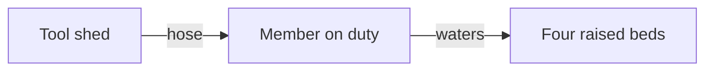

# Filename: Mesh/Programs/(Program) [Name]/Map/(Program) [Name] . ([Type]) [Title].md

/*
  A part is one Mesh note of a program. A note is a part when its `parent` chain reaches the root note.
  `flint ite part add <program> --kind <type id> --title "<title>" [--parent <part>]` makes it with a map change:
  a person's change applies at once, an agent's change is a proposal that a person applies.
  Each change of the structure (the title, the type, the parent) is a map change. Never write a new part file,
  a `parent`, or a `(Type)` word with your own tools. `flint ite part set` changes the prose and the
  fields that are not structure: a person's change writes at once, and an agent's change is a proposal (one map
  change, `edit`) that a person applies. `flint ite link` is the same for a link.
  A note of another type (a Task, a Person) is a part when its `parent` names a part of the program: give it its
  parent with a map change (op move).

  THE FILE NAME
  - "(Program) <Name> . (<Type>) <Title>.md", for example "(Program) Club Launch Night . (Milestone) Venue booked.md".
  - The type is the last (Type) word of the file name. It is one of the `types` of the root note
    (`flint ite types` lists the types of this Flint). The type id is the name in lower case, spaces as "-".
    A change of type is a rename with a new (Type) word: the map change op rename with `kind`.
  - The title has none of the characters \ / : * ? " < > | # ^ [ ]. The name is unique in the Mesh.
  - The title starts with a word, not a number: a number after the (Type) word reads as the number of an artifact,
    as in "(Task) 1099 ...". Write "A full hall and 30 new members", not "80 guests".
  - The folder Map/ is the default home of a new part. A folder is for a person only: the membership is `parent`.
  - The name starts with the stem of the root note: "<stem of the root note> . (<Type>) <Title>.md". A root note
    with another type word or folder gives its own stem, for example "(Product) Flint . (Feature) Local Flint.md".

  FRONTMATTER CONTRACT. Replace the VALUES, keep the shapes. No comment in the frontmatter.
  - id: a new UUID v4 (uuidgen | tr A-Z a-z). It never changes. Each map change and each place names the part by
    this id. Write it with no quotes (id: <uuid>), so that grep "^id: <uuid>" finds the note.
  - tags: always "#ite/part".
  - parent: one wikilink to the part that holds this part, or to the root note "[[(Program) <Name>]]" for a top part.
  - A connection is a key whose value is one wikilink or a list of wikilinks: next, uses, depends-on, informs, owner,
    blocks, refers-to. Each wikilink gives one link, with the key as the connection. Use the connections of the types
    of the program (`flint ite types`). Name a link only when it is true.
  - owner: the person or the role that answers for the part, as a wikilink. Omit it when nobody owns the part.
  - sources: optional, the notes and the pages that the part comes from (wikilinks or URLs). Each one exists now.
  - ONLY IN A PROGRAM WITH codebase ON ITS ROOT NOTE:
    code-refs: the paths of the code of the part, relative to the codebase: a file, a small folder (ends with /),
    a symbol (path#Name), or a path of another codebase (@<Codebase name>/<path>). Name files, not large folders.
    Each path must exist. The coverage reads them for a type with covers-files.
  - No status: the engine reads no status of a part. Do not write status: active. A note of a type with a status of
    its own (a Task) keeps its status.
  - map-mode: optional, group or layer: how a part with children shows on the canvas. With no value, the canvas
    selects it from the size of the subtree.
  - A part can have more keys of a later module. Keep each key that this template does not name, and add none.
  - template, authors, orb: the Flint conventions. orb holds the by address of `flint address me` (quoted).
  - The part holds no finding, no count, and no place. A command computes these facts, and State/main.json keeps
    the places.

  THE BODY
  - One H1: "(<Type>) <Title>". It is for a person; no code reads it.
  - One to three short paragraphs for a person: what this part is, and what is true when it is done.
    Use the words of the person. One idea for each part. A wikilink in the prose gives a link of the connection mentions.
  - A diagram when the part has a flow, an order of steps, or states: one plain sentence, then one fenced `mermaid` block after the first paragraph. Diagrams in the Prose of [[knw-ite-programs]] has the rules.
*/

````markdown
---
id: GENERATE-UUID4
tags:
  - "#ite/part"
parent: "[[(Program) NAME . (TYPE) TITLE OF THE PARENT]]"
next:
  - "[[(Program) NAME . (TYPE) TITLE OF THE NEXT PART]]"
owner: "[[(Program) NAME . (Person) NAME OF THE OWNER]]"
template: "[[tmp-ite-part-v0.1]]"
authors:
  - "[[@author]]"
orb:
  - "[the output of flint address me]"
---

# (TYPE) [Title]

[One to three short paragraphs for a person: what this part is, and what is true when it is done.]

[Only when the part has a flow, an order of steps, or states: one plain sentence, then one fenced mermaid block. Leave out this block when the part has nothing to draw.]
````

## A complete example

File: `Mesh/Programs/(Program) Garden Share/Map/(Program) Garden Share . (Resource) The beds.md`.

````markdown
---
id: 3f1c9a47-7e2b-4d08-b6a5-91c0e4d27f83
tags:
  - "#ite/part"
parent: "[[(Program) Garden Share . (System) The garden]]"
uses:
  - "[[(Program) Garden Share . (System) Tool shed]]"
owner: "[[(Program) Garden Share . (Actor) Member on duty]]"
template: "[[tmp-ite-part-v0.1]]"
authors:
  - "[[@Nathan]]"
---

# (Resource) The beds

The garden has four raised beds behind the hall. The member on duty waters them on Tuesday and on Saturday, with the hose of the tool shed.

The diagram shows the watering, from the tool shed to the beds.



Nobody knows yet who repairs a bed when its wood breaks.
````

What the example does:

- The file name gives the program, the type `Resource`, and the title. The H1 repeats the type and the title.
- `parent` puts the beds inside the part "The garden". `uses` is a connection: each wikilink is one link.
- `owner` names a part of the same program (an actor), so the link has a target.
- The diagram comes after the first paragraph. Its arrows follow the prose: the member takes the hose from the tool shed, and waters the beds.
- The prose says a gap in plain words. The part has no `status` and no place: the canvas keeps the place of the card in `State/main.json`.
